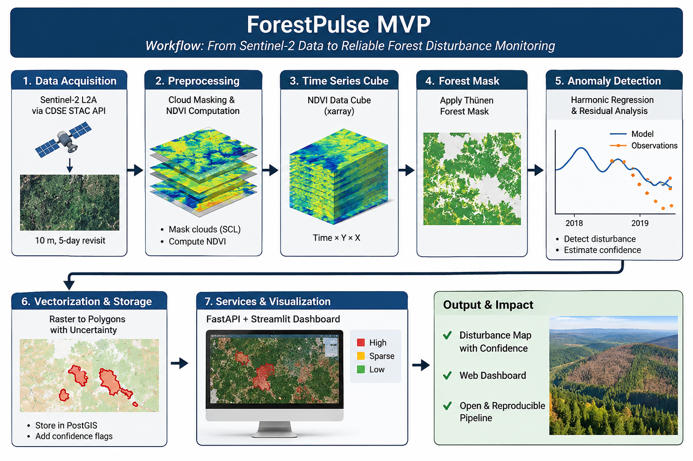

# Forest Change Detection MVP 🌲🛰️

**Seasonal-aware forest disturbance monitoring with uncertainty flagging**

[](https://www.python.org/)
[](https://docs.docker.com/compose/)
[](https://opensource.org/licenses/MIT)
[](https://creativecommons.org/licenses/by/4.0/)

A reproducible remote-sensing pipeline for identifying changes in forest condition from Sentinel-2 Level-2A imagery, applied to the 2019 bark beetle outbreak in the Harz region, Germany.

---

## 📖 Overview

A drop in NDVI does not always indicate forest damage. Seasonal changes, cloud-related gaps, and irregular image availability can all affect the signal. Instead of relying on a single NDVI threshold, this workflow models the seasonal pattern observed in a baseline year and looks for persistent departures from that pattern in a monitoring year. It explicitly records information about the number and timing of valid observations so that detections can be interpreted in light of the available data.

The prototype was tested over a 22 × 22 km area in the Harz Mountains, using Sentinel-2 tile **T32UPC**, **2018** as the baseline year, and **2019** as the monitoring year.

### 🌟 Key Results at a Glance

| Indicator | Result |
| :--- | :--- |
| Sentinel-2 scenes retained in the NDVI cube | 97 |
| Forest pixels retained after masking | 3,547,688 |
| Pixels fitted by the harmonic model | 3,526,387 |
| Pixels flagged as disturbed | **62,557 (1.8% of fitted)** |
| Detection period | 1 June – 22 September 2019 |
| Disturbance polygons | 210 |
| Total mapped polygon area | **374.5 ha** |

*(Note: These are results from the selected tile and analysis period; they should not be interpreted as a complete assessment of the entire Harz region.)*

---

## 🔄 Workflow Architecture

The pipeline follows a five-stage architecture designed to separate phenological variation from structural disturbance signals, culminating in an uncertainty-aware API and dashboard.



### Main Processing Stages

1. **Data Acquisition:** Search CDSE STAC and retrieve Sentinel-2 L2A subsets.
2. **Preprocessing:** Apply SCL cloud mask and calculate NDVI.
3. **Cube Construction:** Assemble observations by date and spatial grid (`ndvi_cube.nc`).
4. **Forest Masking:** Crop, align, and apply the Thünen forest mask (`ndvi_cube_forest.nc`).
5. **Change Detection:** Fit the baseline harmonic model and calculate residuals.
6. **Confidence Assessment:** Evaluate recent observation density and temporal gaps.
7. **Spatial Storage:** Polygonize detections, filter small features, and write to PostGIS.
8. **Delivery:** Serve filtered GeoJSON and display results via FastAPI and Streamlit.

---

## 🛠️ Methodology

### 1. Cloud Masking & NDVI
The Scene Classification Layer (SCL) is used to remove observations affected by clouds, cloud shadows, cirrus, snow, and water. SCL classes 4 (vegetation), 5 (bare soil), and 2 (dark area) are retained. NDVI is calculated for each valid observation: `NDVI = (B08 - B04) / (B08 + B04)`. Scenes with fewer than 5% valid pixels after cloud masking are excluded.

### 2. Forest Masking
The workflow uses the Thünen Institute's **Bestockte Holzbodenkarte 2018** (Stocked Forest Area Map) to restrict the analysis to forested areas (96.5% overall accuracy). The mask is cropped to the study-area bounds and aligned to the NDVI cube grid before application.

### 3. Seasonal Harmonic Baseline (Novelty)
For each forest pixel, a harmonic regression is fitted to valid 2018 observations:

\[
NDVI(t) = a + c1*sin(2*pi*t/365) + d1*cos(2*pi*t/365) + c2*sin(4*pi*t/365) + d2*cos(4*pi*t/365)
\]

*A linear trend term is deliberately excluded.* During early iterations, including a trend term led to unrealistic extrapolated NDVI values. The parameters are estimated with bounded `scipy.optimize.least_squares` (Intercept bounds: `[0, 1]`, Harmonic bounds: `[-2, 2]`).

### 4. Residual-Based Disturbance Detection
The fitted 2018 seasonal model is used to estimate the expected NDVI for 2019. The residual is calculated as `r(t) = Observed_NDVI(t) - Predicted_NDVI(t)`.
A pixel is flagged when the residual is **below -0.20 NDVI for three consecutive valid observations**. To reduce spring phenology-related false alarms (a documented issue in NRT monitoring [5]), only detections from **June through September** are retained.

### 5. Confidence and Observation Coverage
Each detection is accompanied by observation-coverage information:
*   `obs_density_60d`: Number of valid observations in the 60 days before detection.
*   `max_gap_days`: Largest gap between valid observations during the monitoring year.

**Decision Rules:**
*   Fewer than 3 valid observations in the preceding 60 days: `low`
*   Maximum temporal gap greater than 45 days: `sparse`
*   Otherwise: `high`

---

## 📂 Repository Structure

```text
forestpulse-mvp/
├── docker-compose.yml
├── requirements.txt
├── .env                         # Local CDSE credentials; DO NOT COMMIT
├── .gitignore
├── README.md
├── docs/
│   └── workflow.png             # Architecture diagram
├── data/
│   ├── cache/                   # Cached Sentinel-2 GeoTIFFs
│   ├── forest_mask.tif
│   ├── ndvi_cube.nc
│   ├── ndvi_cube_forest.nc
│   ├── disturbance_2019_forest.nc
│   └── disturbance_preview.png
├── src/
│   ├── ingest/
│   │   ├── stac_fetch.py
│   │   └── stac_fetch2.py       # Gap-filling download
│   ├── preprocess/
│   │   ├── cloud_mask.py
│   │   ├── ndvi.py
│   │   ├── build_cube.py
│   │   └── mask_forest.py
│   ├── detect/
│   │   └── harmonic_anomaly.py  # Novel detection algorithm
│   ├── store/
│   │   └── postgis_writer.py
│   ├── api/
│   │   └── main.py
│   └── dashboard/
│       └── app.py
└── tests/
    └── test1.py
```

---

## 🚀 Setup & Installation

### Requirements
*   Windows 10/11 with WSL 2 and Ubuntu (or equivalent Linux environment)
*   Docker Desktop with the WSL 2 backend (for PostGIS)
*   Python 3.12 (3.11 is also supported)
*   A [CDSE account](https://eodata-s3keysmanager.dataspace.copernicus.eu/panel/s3-credentials) with S3 access credentials
*   The Thünen forest mask for the study area

### Create the Environment
```powershell
mkdir C:\projects\forestpulse-mvp
cd C:\projects\forestpulse-mvp

py -3.12 -m venv .venv
.\.venv\Scripts\Activate.ps1

pip install -r requirements.txt
```

Create a local `.env` file for the CDSE S3 credentials:
```text
CDSE_S3_ACCESS_KEY=your_access_key
CDSE_S3_SECRET_KEY=your_secret_key
```
**Note:** Do not commit `.env`, S3 credential files, or large data caches to GitHub.

---

## 🏃‍♂️ Running the Workflow

Run the stages in order from the project root.

**1. Start PostGIS**
```powershell
docker compose up -d
```

**2. Retrieve Sentinel-2 scenes**
```powershell
python src/ingest/stac_fetch.py
# If additional observations are needed to fill temporal gaps:
python src/ingest/stac_fetch2.py
```

**3. Build the NDVI cube**
```powershell
python src/preprocess/build_cube.py
```

**4. Apply the forest mask**
*(Ensure the Thünen raster is at `data/forest_mask.tif`)*
```powershell
python src/preprocess/mask_forest.py
```

**5. Detect forest disturbance**
```powershell
python src/detect/harmonic_anomaly.py
```
*Note: This stage takes approximately 10–20 minutes depending on machine specs.*

**6. Write polygons to PostGIS**
```powershell
python src/store/postgis_writer.py
```

### Start the API & Dashboard
Start the API in one terminal:
```powershell
uvicorn src.api.main:app --reload --port 8000
```
*(Interactive API docs available at `http://localhost:8000/docs`)*

Start the dashboard in a second terminal:
```powershell
streamlit run src/dashboard/app.py
```
Open `http://localhost:8501` to view the Folium map, apply confidence filters, and view the results table.

---

## ⚙️ Main Parameters

| Parameter | Value | Script |
| :--- | :--- | :--- |
| `BASELINE_YEAR` | 2018 | `harmonic_anomaly.py` |
| `MONITOR_YEAR` | 2019 | `harmonic_anomaly.py` |
| `RESIDUAL_THRESHOLD` | -0.20 | `harmonic_anomaly.py` |
| `PERSISTENCE` | 3 consecutive valid obs | `harmonic_anomaly.py` |
| `MIN_R2` | 0.05 | `harmonic_anomaly.py` |
| `GROWING_SEASON_MONTHS` | `(6, 7, 8, 9)` | `harmonic_anomaly.py` |
| `MIN_AREA_HA` | 0.5 | `postgis_writer.py` |
| `MAX_CLOUD` | 20% | `stac_fetch.py` |

*These settings were used in the documented Harz experiment. They are not universal thresholds for every forest type or region.*

---

## ⚠️ Limitations

1.  **Baseline year:** 2018 was an unusually dry year. It may not represent undisturbed seasonal conditions and could mask some subsequent changes.
2.  **Study-area coverage:** The analysis covers one Sentinel-2 tile (~22 × 22 km). A full Harz assessment requires mosaicking.
3.  **Forest-mask date:** The Thünen mask represents 2018 conditions. It does not describe post-disturbance land cover.
4.  **Stationary seasonal model:** The harmonic model assumes the baseline seasonal pattern is an appropriate reference. It is not designed to represent gradual, multi-year degradation.
5.  **Polygon confidence artifact:** 36 polygons were assigned `none` because their centroid fell outside the disturbed patch (e.g., C-shaped geometries). The dashboard filters these by default. 
6.  **Validation:** Spatial patterns are consistent with known regional damage, but results should be treated as a prototype assessment pending further comparison with independent reference data.

---

## 🔮 Possible Next Steps
*   Test a 2017 baseline to reduce the influence of the 2018 drought.
*   Extend the analysis to additional Sentinel-2 tiles and build a full Harz mosaic.
*   Compare detections with available FNEWs disturbance maps.
*   Review the polygon-centroid confidence assignment and handle complex geometries.
*   Add automated `pytest` tests for harmonic fitting and polygon filtering.
*   Add GitHub Actions for linting and testing.
*   Containerize the API and dashboard so the complete app launches via `docker compose up`.

---

## 📚 References and Data Sources

1.  Copernicus Data Space Ecosystem — [STAC API](https://stac.dataspace.copernicus.eu/v1) and [S3 credentials manager](https://eodata-s3keysmanager.dataspace.copernicus.eu/panel/s3-credentials).
2.  Langner, N., Oehmichen, K., Henning, L., Blickensdörfer, L. and Riedel, T. (2022). *Bestockte Holzbodenkarte 2018*. [https://doi.org/10.3220/DATA20221205151218](https://doi.org/10.3220/DATA20221205151218).
3.  FNEWs — [Fernerkundungsbasiertes Nationales Erfassungssystem Waldschäden](https://www.fnews-wald.de/).
4.  Universität Trier — [ForestPulse research project information](https://www.uni-trier.de/universitaet/fachbereiche-faecher/fachbereich-vi/faecher/geoinformatik/umweltfernerkundung-und-geoinformatik/forschungsprojekte).
5.  Huo, L. et al. (2026). *Comparative study of near real-time monitoring algorithms for early detection of bark beetle infestations in Germany with Sentinel-2*. European Journal of Remote Sensing. [https://doi.org/10.1080/22797254.2026.2662660](https://doi.org/10.1080/22797254.2026.2662660).

---

## 📝 Citation

If you use this implementation or build on the workflow, please cite the repository:

```text
forest-change-detection-mvp (2026).
Seasonal-aware forest disturbance monitoring with uncertainty flagging.
GitHub repository: https://github.com/rsreza/forest-change-detection-mvp
```

**Code license:** MIT  
**Documentation license:** CC BY 4.0
